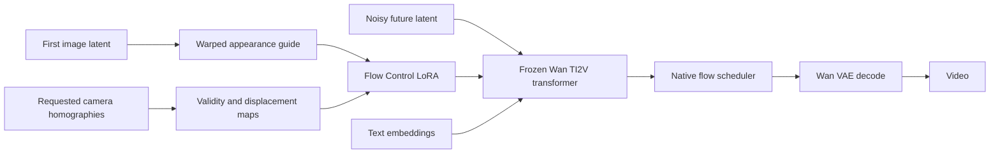

# Architecture walkthrough

## Data path

## Conditioning representation

`flow_geometry.py` creates a homography from the first view to each current view for every RGB frame. The camera path is sampled at the Wan temporal stride of four. `build_image_condition()` maps each destination latent grid location back into the first image and samples its appearance guide. It also supplies a validity mask and two normalized displacement channels. The adapter receives no target video pixels.

The condition has 51 channels: 48 warped first image latent channels, one validity channel, and two displacement channels. A moving path is a geometric hint. It does not encode scene depth or guarantee that the warped latent equals an encoded target frame.

## Backbone dimensions and adapter placement

The pinned transformer configuration is Wan2.2 TI2V 5B with 30 blocks, 24 attention heads, head dimension 128, and feed forward width 14,336. The hidden width is 3,072 because 24 heads times 128 dimensions per head equals 3,072. The checkpoint tensor header independently confirms the 3,072 and 14,336 projection dimensions.

The backbone, VAE, and text encoder stay frozen. The controller adds a guide projection and rank 16 LoRA updates with alpha 16 in blocks 0 through 15. Blocks 16 through 29 remain unchanged. Each adapted block wraps five linear projections: attention Q, K, and V, then the feed forward input and output projections. This gives 80 wrapped projections. The original linear weights remain frozen. Only the low rank A and B factors train.

The guide projection is a Conv3d with 51 input channels and 3,072 output channels. Its kernel and stride are both `(1, 2, 2)`. It preserves the latent time axis and halves the spatial grid to match the Wan patch grid. The checkpoint has 14,261,248 trainable parameters, calculated as follows.

| Component | Calculation | Parameters |
| --- | --- | ---: |
| One attention LoRA | 16 × (3,072 + 3,072) | 98,304 |
| Three attention LoRAs in one block | 3 × 98,304 | 294,912 |
| One feed forward LoRA | 16 × (3,072 + 14,336) | 278,528 |
| Two feed forward LoRAs in one block | 2 × 278,528 | 557,056 |
| Five LoRAs in one block | 294,912 + 557,056 | 851,968 |
| LoRAs in 16 adapted blocks | 16 × 851,968 | 13,631,488 |
| Guide projection weights | 51 × 3,072 × 1 × 2 × 2 | 626,688 |
| Guide projection bias | 3,072 | 3,072 |
| Total trainable parameters | 13,631,488 + 626,688 + 3,072 | 14,261,248 |

The checkpoint stores each LoRA factor as separate tensors. For an attention projection the A shape is `[16, 3072]` and the B shape is `[3072, 16]`. For the feed forward input projection the B shape is `[14336, 16]`. For the output projection the A shape is `[16, 14336]`.

## Latent and token dimensions

At the packaged video size of 1,280 by 704 pixels and 121 frames, the VAE latent has shape `[1, 48, 31, 44, 80]` in batch, channel, time, height, width order. The guide projection applies the spatial patch stride of two, producing a transformer grid of `[1, 3072, 31, 22, 40]`. This is 27,280 tokens per sample. The first temporal latent plane remains the input image anchor.

## Inference and training target

Loss is computed only over future latent planes. The native scheduler uses flow prediction and a shifted UniPC schedule. Inference with the `teacher` camera residual reference computes the frozen positive text prediction, then adds the requested adapter correction relative to that baseline before native text CFG. The negative text branch stays frozen.

Each paired command receives the same noisy future derived from its source static clip. If σ is the sampled noise level, the target is the frozen static input teacher prediction plus `(static_clean - requested_clean) / σ`. This teacher relative camera edit is the implemented objective. Its latent loss and projection diagnostics measure training target agreement. They do not certify RGB motion, control on new scenes, or physical camera pose.

## Main modules

* `flow_cache.py`: frozen VAE and text encoding, source checks, and native latent cache loading.
* `flow_geometry.py`: camera paths, homographies, and warped appearance hints.
* `flow_control.py` and `control_lora.py`: adapter modules and condition injection.
* `flow_train_delta.py`: the exact step 300 training implementation.
* `flow_infer.py`, `flow_anchor.py`, and `flow_guidance.py`: native I2V generation and camera guidance.
* `measure_flow_video.py`: sparse optical flow tracks and requested path comparisons.
* `measure_flow_preservation.py`: aligned overlap region image comparison at sampled frames.
* `summarize_flow_adherence.py`: pixel and normalized ADE/FDE, coverage, signed motion gain, cosine, and robust global 2D fit diagnostics.

The metrics are complementary. Track path adherence measures apparent sparse point motion. Preservation compares aligned visible overlap. Human inspection is still needed for artifacts and newly revealed regions.

